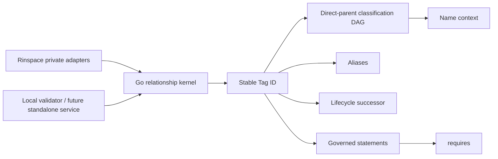

# Rinspace Tags

[中文](README.zh-CN.md) · [Rinspace](https://rinspace.com)

Rinspace Tags is the knowledge-relationship kernel behind Rinspace. It models
how stable knowledge identities are organised, distinguished, governed, and
connected. A Tag is more than a label attached to content: it can be a
classification node, a knowledge entry, a citation target, and the endpoint of
reviewed semantic relations.

The first source candidate focuses on the relationship kernel:

- stable positive integer Tag IDs that are never replaced by names or slugs;
- Unicode-normalised names with disjoint direct-parent contexts;
- multiple direct parents in a directed acyclic classification graph;
- aliases that resolve to Tags without becoming Tags themselves;
- lifecycle successors that preserve identity through merges;
- deterministic merge, deprecate, archive, and restore transition plans with
  replay-compatible idempotency identities;
- governed semantic statements, beginning with acyclic `requires` relations;
- deterministic validation and ancestor/descendant projections.

Rinspace does not assign a hard-coded `tag_type`. Knowledge roles come from
context, explicit relationships, and governed vocabulary bindings.



## Local validation

Go 1.24 or newer is required.

```bash
go test ./...
go run ./cmd/rinspace-tagsctl validate \
  -file examples/synthetic-knowledge-base/graph.json
```

The validator accepts one `rinspace-tags-graph/v1` JSON snapshot, rejects
unknown fields, limits input to 16 MiB, and emits a deterministic validation
report. The example uses synthetic data.

## Integration model

The Go module is the shared implementation boundary. A product supplies
storage, identity, policy, Git, and rendering adapters around the public core.
Rinspace consumes reviewed releases by exact semantic version and integrity;
it does not consume `main`, `latest`, an unreviewed pull request, or a mutable
working tree.

The current candidate does not yet include the PostgreSQL reference store,
standalone HTTP service, Gitea/Renderer adapters, OIDC integration, or
TypeScript SDK. Those layers will use the same core rather than implement a
parallel Tag model.

`core/lifecycle` validates lifecycle intent and produces a pure transition
plan. The consuming adapter locks rows, checks product-specific name contexts,
applies associations, writes audit/outbox records, and performs external
repository actions in its own transaction boundary.

## Relationship semantics

| Relationship | Meaning | Editable fact |
| --- | --- | --- |
| `child -> parent` | Classification context | Direct edge |
| alias | Name resolution | Alias-to-Tag binding |
| successor | Merge or deprecation redirect | Lifecycle binding |
| `requires` | Learning or logical prerequisite | Governed statement |
| authored reference | A source document cites knowledge | Publication projection |
| object association | External content is associated with a Tag | Product adapter |

Transitive classification links are derived projections. They are never
edited as if they were direct facts.

## License and contributions

Rinspace-owned community source is licensed under
[`AGPL-3.0-only`](LICENSE). Contributors retain copyright and license
intentional contributions under Apache License 2.0 through the repository
[contribution terms](CONTRIBUTION-LICENSE.md) and [DCO 1.1](DCO). See
[CONTRIBUTING.md](CONTRIBUTING.md) and [THIRD_PARTY_NOTICES.md](THIRD_PARTY_NOTICES.md).
