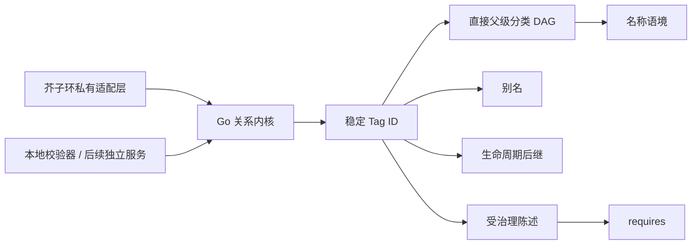

# 芥子环标签系统

[English](README.md) · [rinspace.com](https://rinspace.com)

芥子环标签系统是芥子环组织知识关系的核心。这里的 Tag 不是附在内容上的普通字符串；
它具有稳定身份，可以同时成为分类节点、知识条目、引用目标和受治理关系的端点。

首个源码候选集中交付关系内核：

- 永不以名称或 slug 代替的正整数稳定 Tag ID；
- Unicode 规范化名称与互不重叠的直接父级语境；
- 支持多个直接父级的有向无环分类图；
- 只负责名称解析、不会变成独立 Tag 的别名；
- 合并后仍保留原身份的生命周期后继关系；
- 具有可重放幂等身份的合并、弃用、归档与恢复确定性迁移计划；
- 从无环 `requires` 开始的受治理知识陈述；
- 确定性的图校验、祖先与后代投影。

芥子环不设置硬编码的 `tag_type`。知识角色来自语境、明确关系和受治理词表。



## 本地校验

需要 Go 1.24 或更高版本。

```bash
go test ./...
go run ./cmd/rinspace-tagsctl validate \
  -file examples/synthetic-knowledge-base/graph.json
```

校验器读取一个 `rinspace-tags-graph/v1` JSON 快照，拒绝未知字段，将输入限制在
16 MiB，并输出顺序稳定的校验报告。示例只使用合成数据。

## 集成方式

Go module 是共享实现边界。产品在公共核心外围提供存储、身份、权限、Git 和渲染
适配器。芥子环私仓只按精确语义版本和完整性摘要消费通过审查的发行版，不消费
`main`、`latest`、未审查 PR 或可变工作树。

当前候选尚未包含 PostgreSQL 参考存储、独立 HTTP 服务、Gitea/Renderer 适配器、
OIDC 和 TypeScript SDK。这些能力随后接入同一核心，不会维护另一套 Tag 模型。

`core/lifecycle` 校验生命周期意图并生成纯状态迁移计划。消费方适配层负责行锁、
产品名称语境检查、关联变更、审计/outbox 以及外部仓库动作，并把它们放在自己的
事务边界内执行。

## 关系语义

| 关系 | 含义 | 可编辑事实 |
| --- | --- | --- |
| `child -> parent` | 分类语境 | 直接边 |
| alias | 名称解析 | 别名到 Tag 的绑定 |
| successor | 合并或弃用跳转 | 生命周期绑定 |
| `requires` | 学习或逻辑前置 | 受治理陈述 |
| authored reference | 源文档引用知识 | 发布投影 |
| object association | 外部内容关联 Tag | 产品适配层 |

传递分类关系属于派生投影，不能被当作直接事实编辑。

## 许可证与贡献

Rinspace 自有社区版源码采用 [`AGPL-3.0-only`](LICENSE)。贡献者保留著作权，并通过
[贡献条款](CONTRIBUTION-LICENSE.md)与 [DCO 1.1](DCO)，按 Apache License 2.0
许可有意提交的贡献。参见 [CONTRIBUTING.md](CONTRIBUTING.md) 和
[THIRD_PARTY_NOTICES.md](THIRD_PARTY_NOTICES.md)。
